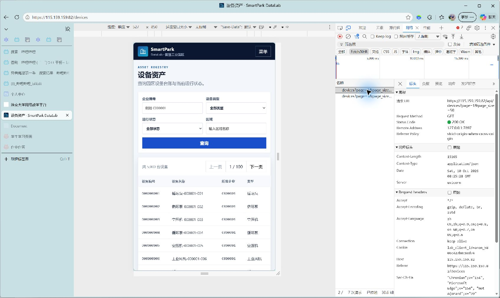
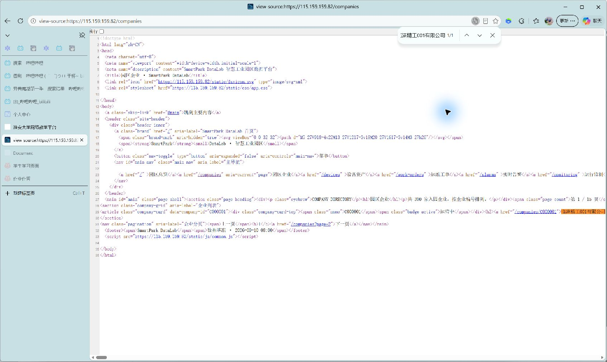
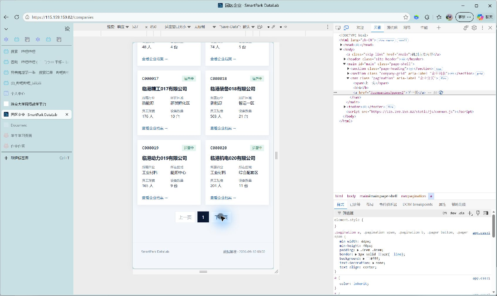
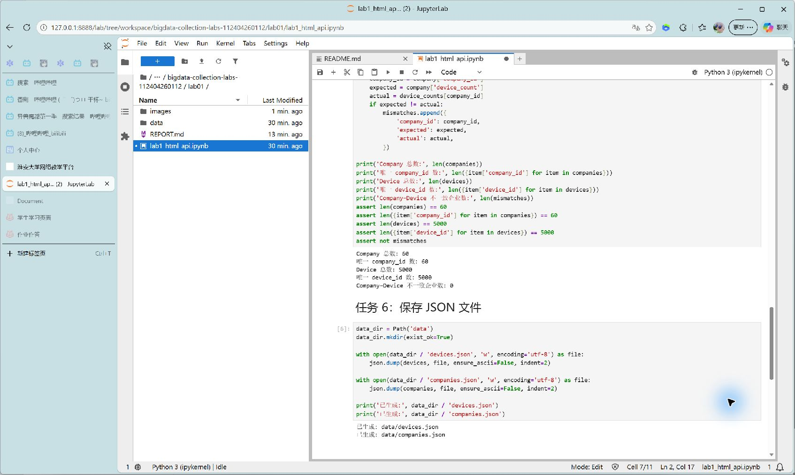

# Lab 1 实验报告

## 学生信息

- **姓名：** ZYC
- **学号：** 112404260112
- **班级：** 数据1241
- **GitHub 用户名：** KilluaZoldyck101
- **仓库地址：** https://github.com/KilluaZoldyck101/bigdata-collection-labs-112404260112

## 任务 1：判断数据加载方式

### 1.1 Device：判断动态加载并找到 API

- 页面：`/devices`
- 数据加载方式：动态加载
- 判断依据：在“查看网页源代码”中，页面只有表格容器和“正在加载”提示，找不到实际设备名称。Network 的 Fetch/XHR 显示页面通过 API 读取设备 JSON 数据。
- Request URL：`https://115.159.159.82/api/devices?page=1&page_size=50`
- Request Method：`GET`
- Query 参数：`page`、`page_size`；本实验采集时依次请求 `page=1..100`，`page_size=50`。




### 1.2 Company：判断静态加载

- 页面：`/companies`
- 数据加载方式：静态加载
- 判断依据：在“查看网页源代码”中可以直接找到真实企业名称（例如“临港精工001有限公司”）及其企业卡片 HTML，无需先调用列表 API。



## 任务 2：Device API 分页采集

### 2.1 API 分页结构

| 含义 | JSON 字段 |
|---|---|
| 当前页 | `page` |
| 每页条数 | `page_size` |
| 设备总数 | `total` |
| 设备列表 | `items` |

### 2.2 关键代码

```python
total = first_page["total"]
page_size = first_page["page_size"]
total_pages = (total + page_size - 1) // page_size

devices = []
for page in range(1, total_pages + 1):
    response = session.get(
        API_URL,
        params={"page": page, "page_size": page_size},
        timeout=TIMEOUT,
    )
    response.raise_for_status()
    page_data = response.json()
    devices.extend(page_data["items"])
```

### 2.3 采集结果

- 每页条数：50
- 设备总数：5000
- 程序计算得到的总页数：100
- 最终采集设备数：5000
- 唯一 `device_id` 数：5000

总页数必须由接口实际返回的 `total` 和 `page_size` 计算。这样数据规模或服务端每页条数变化时，程序仍能自动覆盖全部页面；写死页数会导致漏采或多请求。

## 任务 3：Company HTML 解析

### 3.1 企业记录 Selector

- 企业记录 selector：`article.company-card`
- 第 1 页企业记录数：20

该 selector 主要使用稳定、语义明确的 class。它定位的是一条完整企业记录的最外层 `article` 节点，简短且不依赖脆弱的 `nth-child` 位置关系；未采用浏览器 Copy selector 的长路径。

### 3.2 关键代码

```python
cards = soup.select("article.company-card")
card = cards[0]

company_id = card["data-company-id"]
name = card.select_one("h2 a").get_text(strip=True)
status = card.select_one(".company-card-top .badge").get_text(strip=True)

details = {}
for item in card.select("dl > div"):
    details[item.select_one("dt").get_text(strip=True)] = (
        item.select_one("dd").get_text(strip=True)
    )

industry = details["所属行业"]
zone = details["所在区域"]
device_count = int(details["设备数量"].replace(" 台", ""))
```

### 3.3 字段来源说明

1. 字段：`company_id`
   - 来自：HTML 属性
   - 使用的方法：读取企业卡片 `data-company-id` 属性，即 `card["data-company-id"]`。
2. 字段：`device_count`
   - 来自：文本
   - 使用的方法：从当前卡片的 `dt/dd` 信息中读取“设备数量”，去掉“台”后转换为整数。

## 任务 4：Company “下一页”分页

### 4.1 下一页元素

- “下一页” selector：`nav.pagination a:last-of-type`
- 第 1 页 `href` 示例：`/companies?page=2`




### 4.2 关键代码

```python
next_link = soup.select_one("nav.pagination a:last-of-type")
next_href = next_link["href"]
next_url = urljoin(current_url, next_href)
```

程序每轮请求 `current_url`，解析本页企业卡片后定位“下一页”链接。把链接的相对 `href` 用 `urljoin` 转为下一页绝对 URL，并赋值给 `current_url`；循环三次即可得到连续三页数据。

### 4.3 三页采集结果

| 页码 | 企业数 |
|---|---:|
| 1 | 20 |
| 2 | 20 |
| 3 | 20 |
| **合计** | **60** |

- 唯一 `company_id` 数：60

## 任务 5：结果验证

### 5.1 最终结果

| 检查项 | 结果 |
|---|---:|
| Company 总数 | 60 |
| 唯一 `company_id` | 60 |
| Device 总数 | 5000 |
| 唯一 `device_id` | 5000 |
| Company–Device 不一致企业数 | 0 |




### 5.2 一致性检查关键代码

```python
device_counts = Counter(x["company_id"] for x in devices)

mismatch_count = 0
for company in companies:
    cid = company["company_id"]
    expected = company["device_count"]
    actual = device_counts[cid]
    if expected != actual:
        mismatch_count += 1
```

`status_code == 200` 只能说明 HTTP 请求被服务器成功处理，不能证明分页没有漏页、记录没有重复、字段没有解析错，也不能证明 Company 与 Device 的数量关系正确。因此还必须验证总数、ID 唯一性和跨数据源的一致性。

## 任务 6：保存采集结果

- `companies.json`：已生成
- `devices.json`：已生成

## 实验结论

本实验先通过源代码和 Network 判断加载方式：Device 使用 API，通过 `total` 与 `page_size` 自动分页采集；Company 直接解析 HTML，并读取“下一页” `href` 连续翻页。随后用总数、ID 去重及 Company–Device 设备数比对完成验证，并保存 JSON 结果。
