# 实验二：房源采集与 MySQL 存储实验报告

## 学生信息

- **姓名：** ZYC
- **学号：** 112404260112
- **班级：** 数据1241
- **GitHub 用户名：** KilluaZoldyck101
- **仓库地址：** https://github.com/KilluaZoldyck101/bigdata-collection-labs-112404260112

## 一、实验目的与环境

本实验使用 `requests` 请求安居客教学站，用 BeautifulSoup 和 CSS 选择器提取房源的 8 个字段；再从页面的“下一页”链接连续采集，去重后保存为 CSV，最后用 PyMySQL 批量写入课程 MySQL，并核对 CSV 与数据库数据。实验文件为 `anjuke.ipynb` 和 `data/houseinfo.csv`。

实验在课程 Docker 环境中的 JupyterLab 完成，Python 使用 `requests`、`beautifulsoup4`、`csv`、`urllib.parse` 和 `pymysql`。MySQL 服务名为 `mysql`，端口为 `3306`，数据库为 `smartpark_lab`。

## 二、第一阶段：MySQL 环境检查与建表

按实验说明启动已有课程环境和 MySQL 后，在 MySQL 终端检查数据库与表，并在 `smartpark_lab` 中建立 `houseinfo`。表共有 9 列：自增长主键 `id` 加 8 个房源字段。房源字段按 `title`、`house`、`address`、`struct`、`area`、`floor`、`maketime`、`price` 的顺序保存；面积和单价保留原网页单位。建表使用 `utf8mb4` 字符集。入库前查询 `COUNT(*)` 的实验记录为 0 条。

```sql
USE smartpark_lab;
DESCRIBE houseinfo;
SELECT COUNT(*) AS before_count FROM houseinfo;
```

这里的 `DESCRIBE` 用于确认字段名、类型及主键，`COUNT(*)` 则记录入库前基数。以下原始终端截图摄于入库后，展示了 `houseinfo` 的 9 字段结构、498 条总数及前 5 条查询；入库前 0 条由首次插入截图中的输出证明。

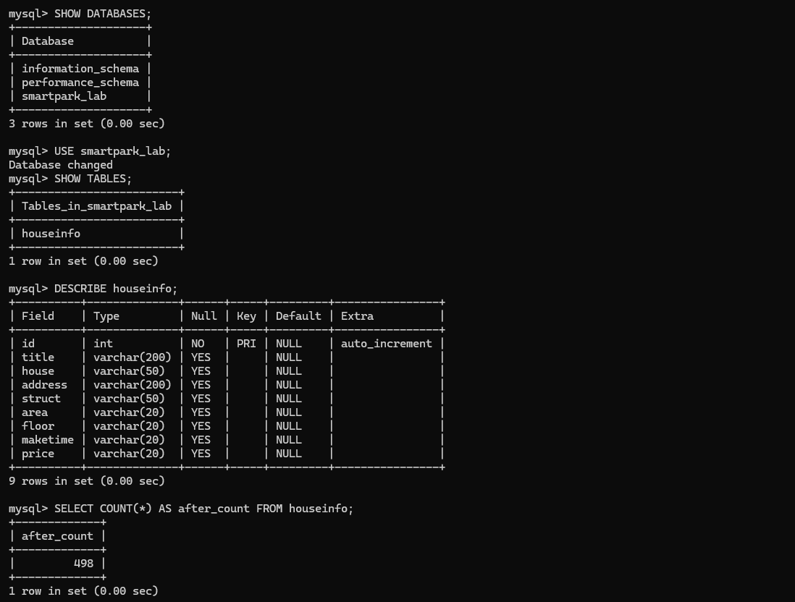

## 三、第二阶段：房源采集与 CSV 存储

### 3.1 访问网页与分析 HTML

Notebook 请求 `http://www.bspider.top/anjuke/`，设置 30 秒超时，调用 `raise_for_status()` 检查 HTTP 错误，再用 BeautifulSoup 解析 HTML。程序同时检查网页标题和 `div.property` 的数量，避免把 HTTP 200 的访问验证页误当作房源页。保存的第一页输出为 HTTP 200、正常房源页标题、60 条房源。

F12 分析时先从标题节点向上找到完整房源容器，再在该容器内定位各字段。Notebook 中保存过从页面根节点开始、带 `nth-child()` 的长选择器；实际解析函数采用相对选择器，降低页面其他区域变化造成的影响。下图是当时在 Chrome Elements 面板定位第一条房源标题的原始截图，可看到外层 `div.property` 和标题节点。

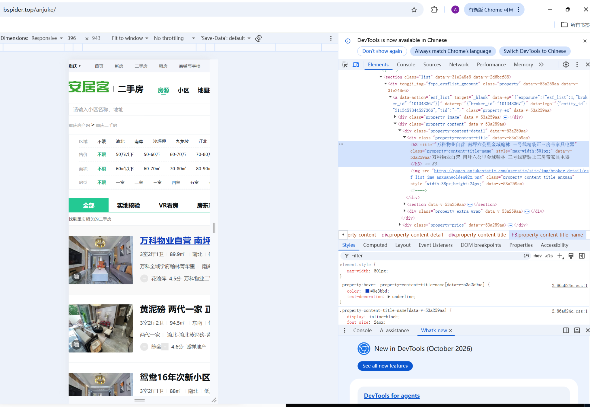

### 3.2 提取 8 个字段

`soup.select("div.property")` 返回本页所有房源节点；对每个 `row`，`select_one()` 只查找该房源内的第一个匹配节点。找不到标题、楼盘、地址或单价节点时，辅助函数返回空字符串，不直接对 `None` 取文本。

| 字段 | Notebook 的实际提取方式 |
|---|---|
| `title` | `h3.property-content-title-name` 的文本 |
| `house` | `p.property-content-info-comm-name` 的文本 |
| `address` | `p.property-content-info-comm-address` 的文本 |
| `struct` | 属性列表 `div.property-content-info > p.property-content-info-text` 的第 1 项 |
| `area` | 同一属性列表的第 2 项，保留 `㎡` |
| `floor` | 同一属性列表的第 4 项；第 3 项是朝向 |
| `maketime` | 遍历属性文本，寻找包含“年建造”的一项；找不到则为空字符串 |
| `price` | `p.property-price-average` 的文本，为每平方米单价 |

户型与建造年代同处房源属性区域，截图中可看到户型节点及“2019年建造”文本。楼盘和地址在相邻的 `property-content-info-comm` 节点中；价格截图显示 `property-price-average` 是单价节点，旁边 `property-price-total` 才是总价，不能混用。

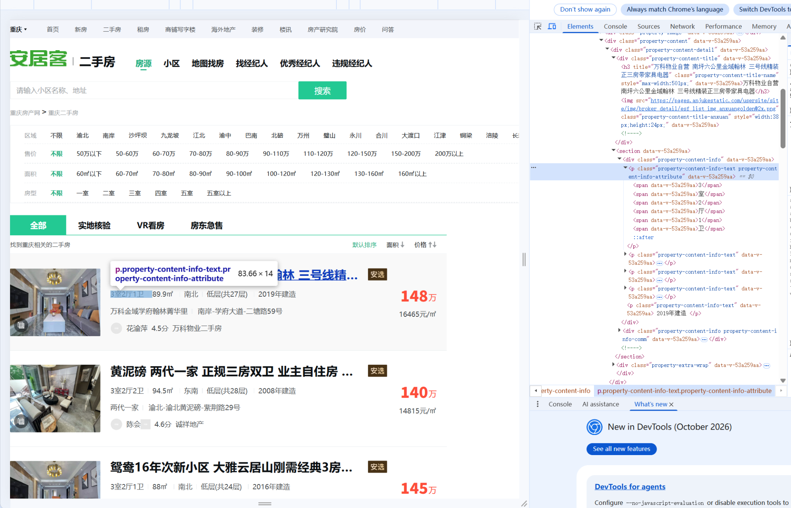

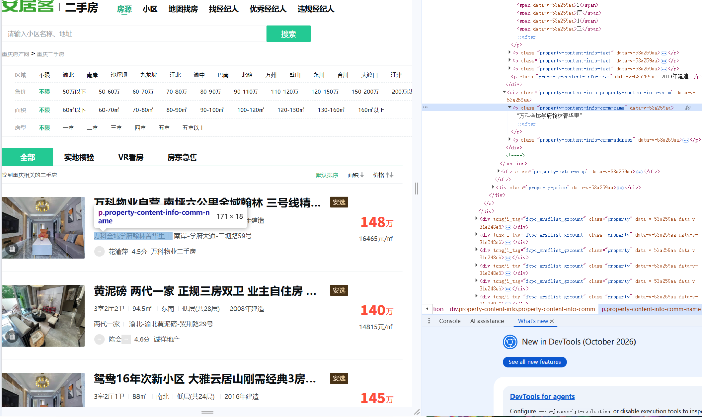

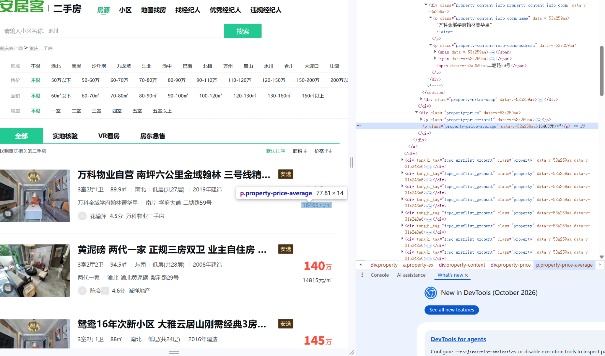

```python
rows = soup.select("div.property")
info = row.select("div.property-content-info > p.property-content-info-text")
values = [node.get_text(strip=True) for node in info]
floor = values[3] if len(values) > 3 else ""
maketime = next((value for value in values if "年建造" in value), "")
```

上面展示的是 Notebook 中定位属性的关键逻辑；完整函数见 `anjuke.ipynb` 的 `parse_house` 单元。第一条房源输出了 8 个字段，并继续检查第二条和本页最后一条。面积、楼层和年代先打印属性组顺序再确定下标，避免把“南北”误写为楼层。

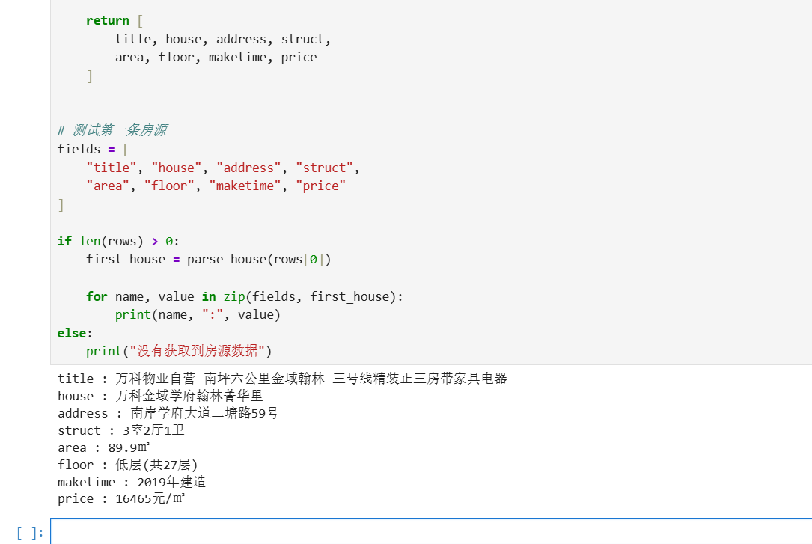

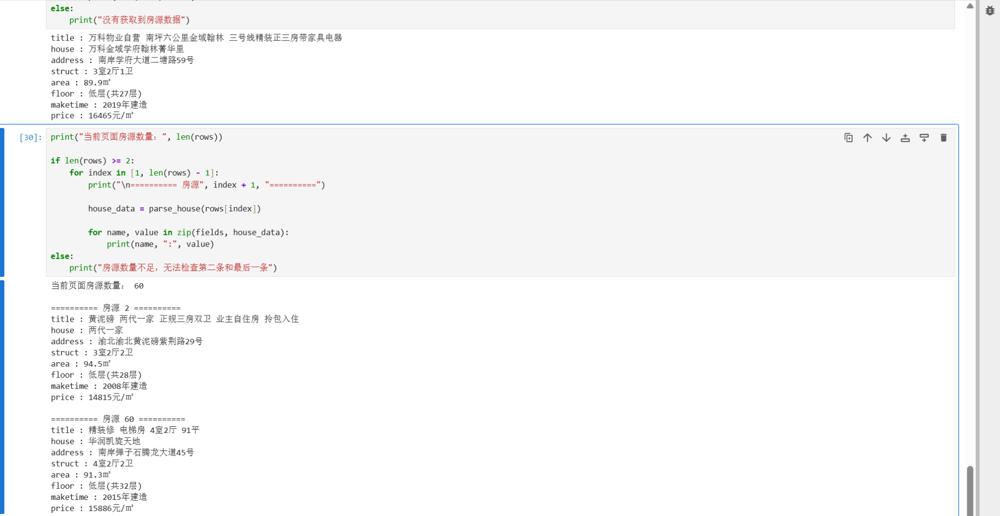

### 3.3 下一页与自动翻页

第一页通过 `soup.select_one("a.next.next-active")` 找到活动的下一页按钮，再读取其 `href`。F12 截图中该节点的属性确为 `href="?page=2"`。Notebook 的保存输出显示用 `urljoin(current_url, href)` 补全为 `http://www.bspider.top/anjuke/?page=2`。第二页检查同样得到 60 条；两页并非完全相同，两页合并后有 119 条不同房源，因为第二页内部有一条重复记录。

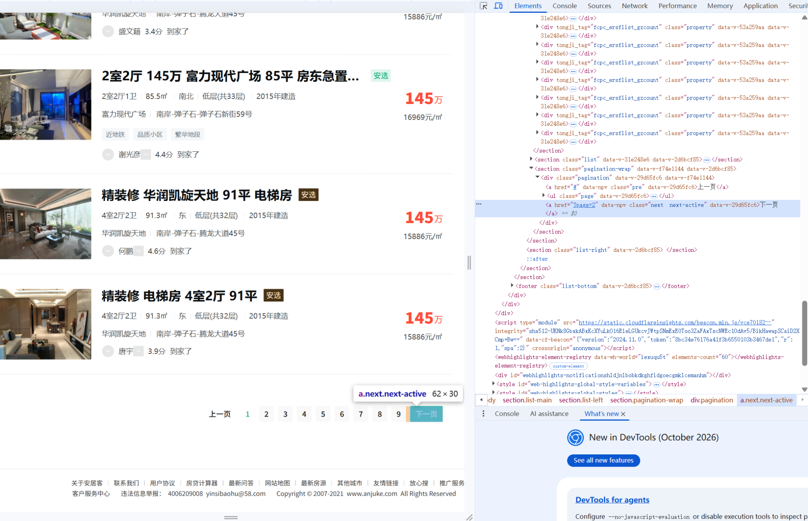

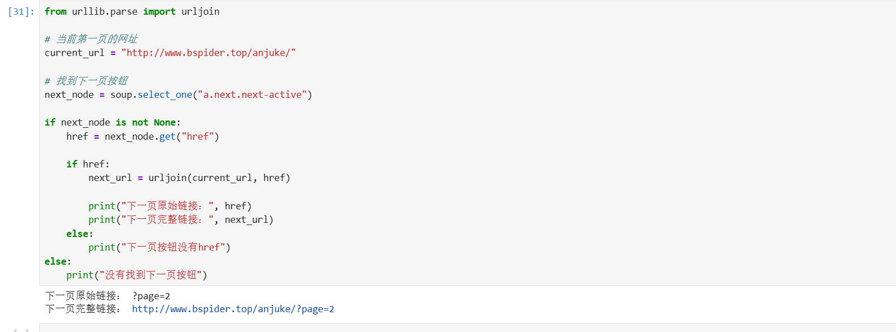

```python
next_node = soup.select_one("a.next.next-active")
href = next_node.get("href") if next_node else None
next_url = urljoin(current_url, href) if href else None
```

完整循环把结果放在 `all_data`，用 `visited` 记录已访问地址。每页检查请求异常、验证页、空列表、与上一页完全相同、分页区域缺失、下一页链接缺失、重复 URL，以及补全后的网址是否仍属于教学站。只有在分页区域存在且活动按钮消失、禁用的下一页按钮仍存在时，才把 `finished` 设为 `True`；30 页安全上限只用于中止异常循环。两页之间等待至少 1 秒。保存的日志显示自动采集 10 页，每页 60 条，累计 600 条，并正常到达末页。

原始日志截图逐页列出第 1—10 页，每页 60 条，累计从 60 增至 600，并显示“已到达末页”。循环中的异常检查和停止条件完整代码保存在 Notebook 中；下图截取的是该单元的末段与实际运行输出。

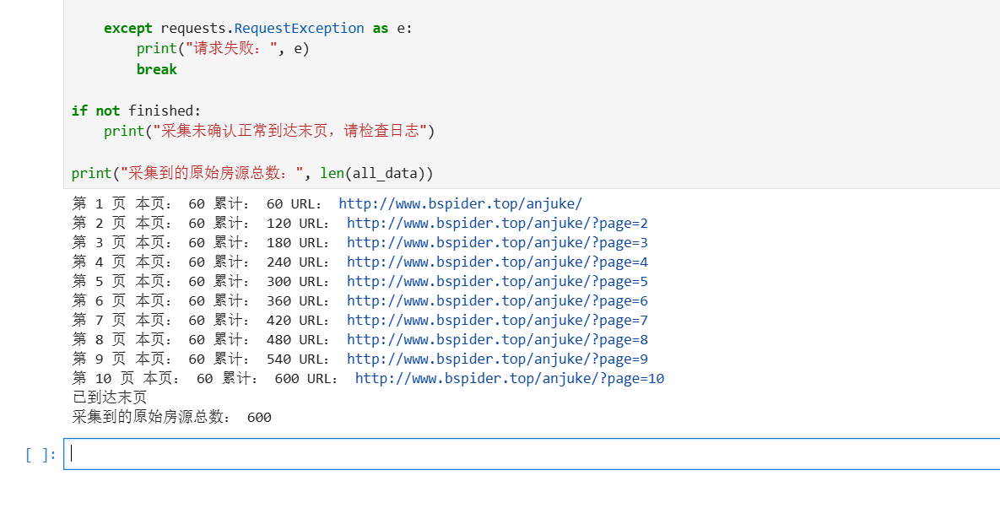

### 3.4 去重、保存与回读 CSV

程序将每条记录的 8 个字段转为元组，再用 `dict.fromkeys()` 按完整内容去重，同时保留首次出现的顺序。保存的 Notebook 输出为去重前 600 条、去重后 498 条，删除 102 条重复记录；`Counter` 分析得到出现重复的房源 84 种。“102 条”是重复出现的额外记录数，“84 种”是至少出现两次的不同房源种类，含义不同。

```python
unique_data = list(dict.fromkeys(tuple(item) for item in all_data))
with open("data/houseinfo.csv", "w", encoding="utf-8-sig", newline="") as f:
    writer = csv.writer(f)
    writer.writerow(fields)
    writer.writerows(unique_data)
```

CSV 使用 `utf-8-sig` 编码及 `newline=""`，写入表头和 498 条数据。之后用 `csv.DictReader` 回读，确认表头顺序和行数，并检查第一条、跨页一条及最后一条的字段。对当前保存的 CSV 再次独立核对：数据行 498 条，表头 8 列，8 字段完全相同的重复行 0 条。Notebook 的质量检查还显示字段数量异常、面积为空、单价为空和楼层格式可疑均为 0。

去重截图同时展示 `dict.fromkeys()` 代码与 600→498、额外重复 102 条的输出。重复分析截图显示出现重复的房源有 84 种，额外重复记录共 102 条；这说明有些房源不止出现两次。

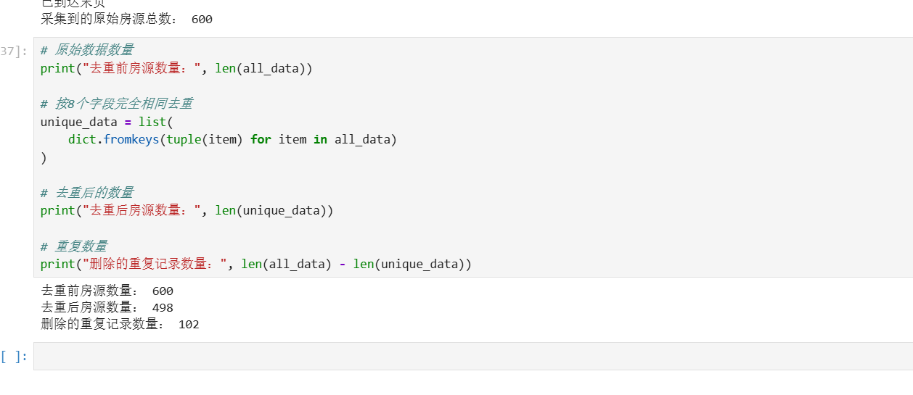

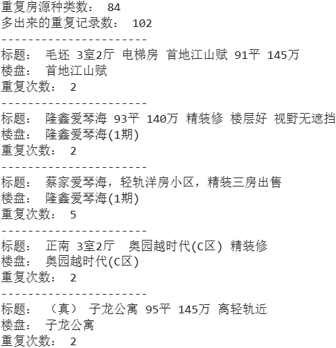

CSV 保存原图展示 `csv.writer` 的编码、表头、数据写入代码和容器内的保存路径，输出为 498 条。回读截图展示 CSV 数据条数 498、8 字段检查为 `True`、完全重复记录为 0，以及三条样本的字段。它们与当前 CSV 的独立检查一致。

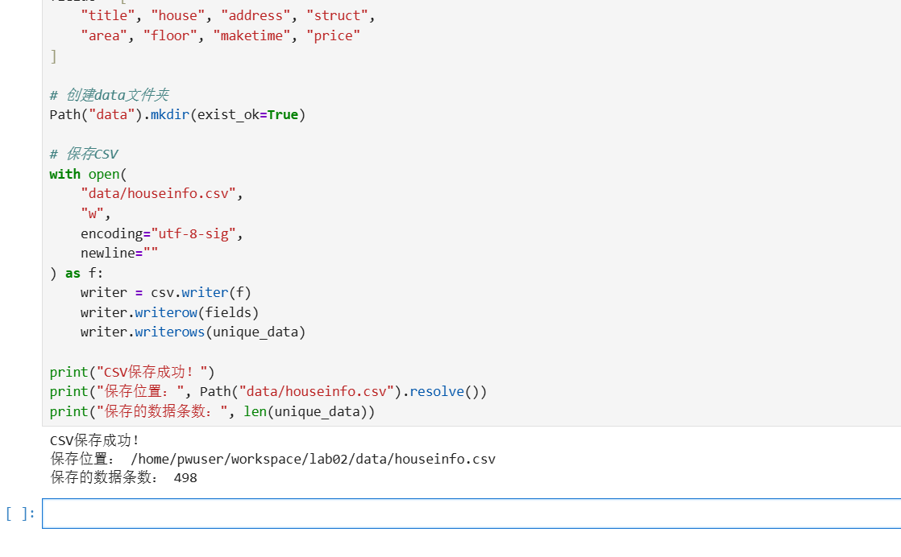

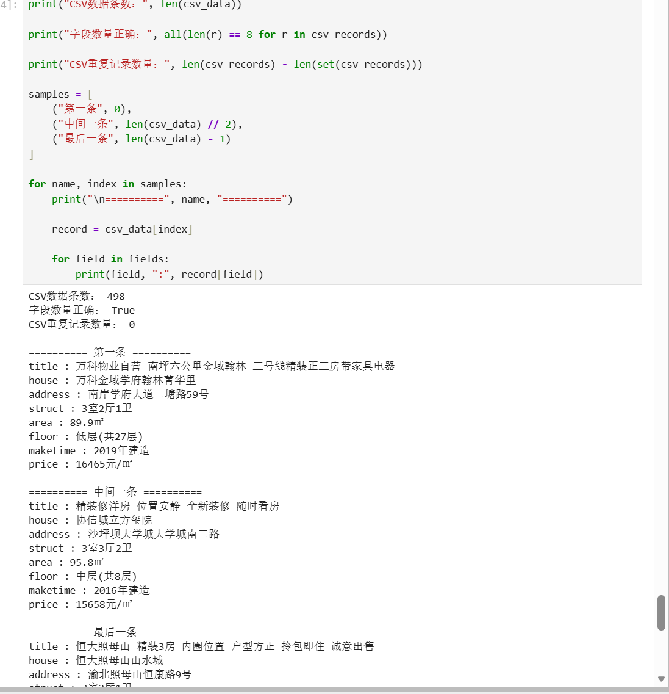


## 四、第三阶段：MySQL 入库与核对

### 4.1 连接与批量写入

Notebook 使用 PyMySQL 连接课程服务，指定 `smartpark_lab` 和 `utf8mb4`，并关闭自动提交。入库程序从 CSV 读取记录，按固定 8 字段顺序组成元组；先查询表内已有房源的 8 字段，形成集合，只把未出现过的 CSV 记录放入 `new_records`。再次用 `dict.fromkeys()` 防止待插入列表自身重复。

```python
existing = set(cursor.fetchall())  # 查询 houseinfo 现有的 8 个房源字段后
new_records = list(dict.fromkeys(
    record for record in records if record not in existing
))
sql = """INSERT INTO houseinfo
    (title, house, address, struct, area, floor, maketime, price)
    VALUES (%s, %s, %s, %s, %s, %s, %s, %s)"""
if new_records:
    affected = cursor.executemany(sql, new_records)
    conn.commit()
```

`executemany()` 用同一条参数化 SQL 批量插入多条记录，8 个 `%s` 依次对应 8 个字段；`commit()` 提交成功的事务。异常处理分支调用 `rollback()` 撤销本次尚未提交的写入，`finally` 先关闭游标再关闭连接。自增长 `id` 本身不能阻止重复房源，实际重跑保护来自 8 字段比较。原始截图保留了首次入库前 0 条、本次实际插入 498 条、入库后 498 条的输出。另一张截图显示重跑时入库前 498 条、准备新增 0 条、入库后仍 498 条，并展示 `executemany()`、`commit()`、`rollback()` 和关闭连接的代码。原始连接及入库前查询截图显示了明文课程密码，因此未放入公开仓库。

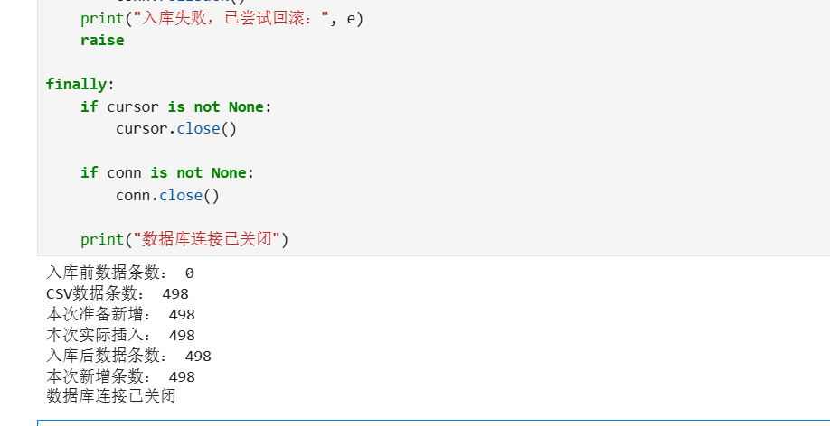

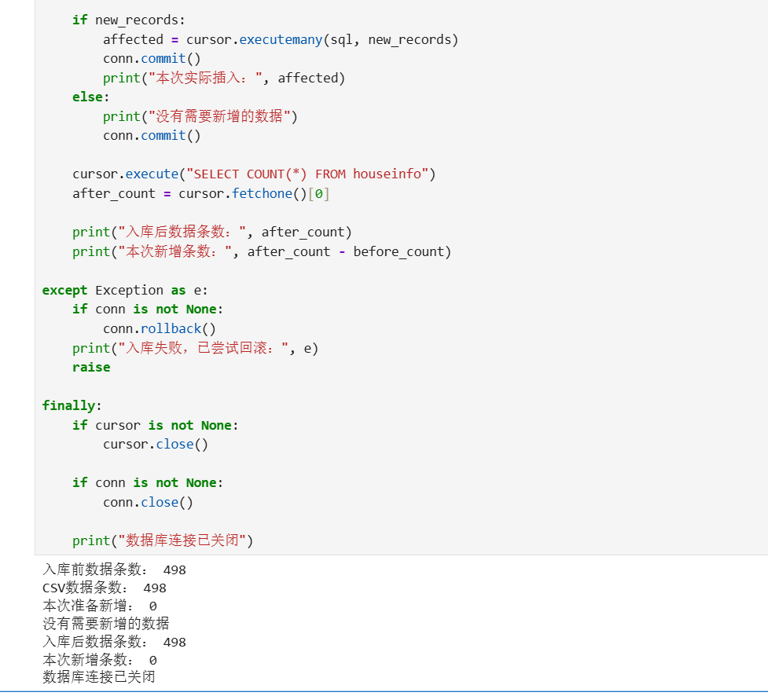

### 4.2 表结构、条数与样本一致性

MySQL 表的 9 列含 `id` 和 CSV 的 8 个房源字段。实验记录中的入库后总数为 498 条，重跑后仍为 498 条。Notebook 最后一项核对从 CSV 取第一条、中间一条、最后一条，以 8 字段作为 SQL 条件查询 MySQL，再与原元组比较；保存的三个结果均为 `True`。这证明抽取的三条样本字段一致，不等于逐条检查了全部 498 条。

MySQL 命令行最初显示中文问号。实验检查发现当前会话部分字符集参数是 `latin1`，而数据库及服务器使用 `utf8mb4`。执行 `SET NAMES utf8mb4;` 后，当前终端会话能正常显示中文；这里是显示编码问题，未重建表或重新导入数据。

字符集检查的原始终端截图显示会话的 `client`、`connection`、`results` 为 `latin1`，数据库和服务器为 `utf8mb4`。下一张原图保留了 `SET NAMES utf8mb4;` 及随后正常显示的中文房源内容。最后一张原图显示三条 CSV 与 MySQL 样本核对均为 `True`。

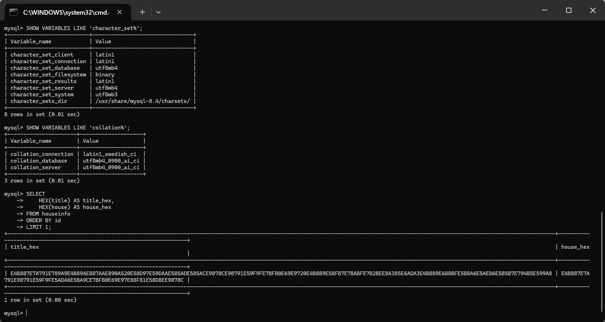

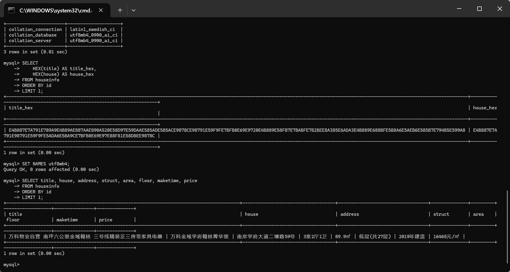

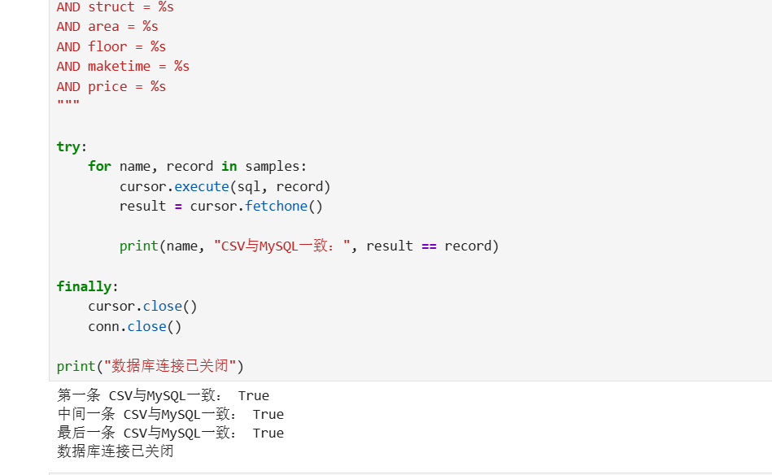


## 五、实验结果与问题处理

| 检查项目 | 实验结果或当前核对状态 |
|---|---:|
| 自动采集 | 10 页，每页 60 条，原始合计 600 条（Notebook 保存输出） |
| 完整 8 字段去重 | 498 条；额外重复 102 条，重复房源 84 种（Notebook 保存输出） |
| CSV | 498 行、8 列、完全重复 0 行（当前文件独立核对） |
| MySQL 首次入库 | 498 条（Notebook 历史操作的原始截图） |
| MySQL 重跑 | 新增 0 条、总数 498 条（Notebook 保存输出） |
| CSV 与 MySQL 抽样 | 第一条、中间一条、最后一条均为 `True`（Notebook 保存输出） |

初次使用简短 User-Agent 时，教学站返回访问验证页，房源数为 0。随后 Notebook 改用完整浏览器 User-Agent，请求到正常房源列表；循环还增加了“访问验证”标题检查。实验没有使用其他绕过技术。另一个问题是 MySQL 命令行中文显示成问号，用 `SET NAMES utf8mb4;` 调整会话字符集后恢复正常，不涉及数据损坏。

本次整理没有重新连接 MySQL；数据库的首次入库和终端查询以当时实验记录及已归档的原始截图为准。Notebook 早期探索单元曾把属性列表第 3 项当作楼层，输出为“南北”；随后打印属性顺序并在最终 `parse_house` 中改取第 4 项。报告采用最终解析函数与保存的 CSV 结果。

## 六、思考题

**1. 下一页怎样取得？** Notebook 在当前页的分页区域找 `a.next.next-active`，用 `.get("href")` 取得 `?page=2` 这样的相对链接，再用 `urljoin(current_url, href)` 补全 URL。每轮请求后更新 `current_url`。只有确认分页区域存在且下一页按钮已禁用，才判定到达末页；链接缺失、重复、越出教学站、空页面或请求失败都作为异常中止。

**2. 结果列表放在哪里，为什么？** 本次把 `all_data = []` 定义在分页采集单元、循环开始之前，而不是放在解析函数的全局输出列表里。`parse_house(row)` 只返回当前一条房源的 8 个字段，分页循环用 `all_data.extend(page_data)` 汇总各页结果。这样解析一条记录和管理整个采集过程各有明确职责，也便于在循环结束后统一去重与检查。

**3. 怎样取得建造年代？节点缺失或顺序改变时怎样处理？** `parse_house` 先取当前房源的属性文本列表，再逐项寻找包含“年建造”的文本；没找到时保留空字符串。因而建造年代不依赖固定下标，属性顺序变化或该项缺失时不会因取年代而下标越界。其他使用下标的字段先检查列表长度；若页面结构改变，仍需重新核对面积、楼层等字段，不能假定所有顺序变化都已自动处理。

## 七、实验总结与证据说明

本实验完成了从教学网页解析、翻页采集、8 字段去重、CSV 回读，到 MySQL 批量入库及抽样核对的流程。采集原始数与去重后数不同，说明每页数量不能直接当作唯一房源数量；重跑前比较数据库已有的 8 字段，避免同批房源再次插入。CSV 当前文件可独立核对，MySQL 历史状态则以保存的 Notebook 输出和已归档的原始终端截图为证。

已插入的图片均来自指定实验对话的原始附件，未重新绘制运行结果。原始连接及单独查询入库前 0 条的两张图露出课程密码，故未提交；首次插入原图中仍可看到“入库前 0 条”。报告中的原始证据已涵盖老师列出的六类要求；保留的 Notebook 还可查看全部代码与输出。
