# 实验三报告：QQ邮箱采集（Playwright版）

- 班级：数据1241
- 姓名：臧曳晨
- 学号：112404260112
- 第1—2课时实验日期：2026-11-20
- 第3—4课时实验日期：2026-11-20
- 第5—6课时实验日期：2026-11-20
- 第7—8课时实验日期：2026-11-20
- 所用工具：Playwright 异步 API
- 工具版本与运行环境：Windows 11 家庭中文版；原课程 Docker 容器；容器内 Python 3.12.3、JupyterLab 4.6.3、Playwright 1.62.0、pandas 3.0.5；教师可视化增量包
- 实验Notebook文件名：`qqmail_lab03_playwright.ipynb`
- GitHub原作业仓库链接：https://github.com/KilluaZoldyck101/bigdata-collection-labs-112404260112（本次仅本地准备，未推送）
- 数据来源（教师练习邮件 / 自备无敏感练习邮件 / 其他，说明）：其他——本人授权的真实 QQ 邮箱普通邮件；报告和公开文件只使用脱敏代号，不展示邮件内容

> 四个阶段写在同一份报告中，最后统一提交一次。截图放在 `images/`，关键代码显示文件名、行号或单元位置，用红框标出，每项附2—3句话解释。只填写真实结果；未完成写明原因。截图、CSV和Notebook输出提交前脱敏，不展示登录凭据。

对应[学生指导书](实验指导书-Playwright版.md)。单元1—2为第一阶段，3—6为第二阶段，7—9为第三阶段，10—12为第四阶段；单元13为选做，未执行。

## 第一阶段：扫码登录（第1—2课时）

### 1. 环境和运行方式

- 使用的启动脚本：课程根目录的 `start-course.bat`；同级 `L07_L08_Playwright_Visual_Addon/start-course-visual.bat`。环境已安装时直接复用，没有重装 Docker 或 Playwright。
- 运行位置：Docker 内 JupyterLab 的 Notebook 代码单元，JupyterLab 从本机 `http://127.0.0.1:8888/lab` 访问；浏览器画面通过本机可视化服务 `127.0.0.1:16080` 查看，认证信息不写入报告。
- 自己新建的Notebook文件名：`qqmail_lab03_playwright.ipynb`，位于原课程 `workspace/lab03/`。
- 所选工具版本：Playwright 1.62.0，使用 `async_playwright()`、`await` 和 `headless=False`。
- 启动或依赖问题及处理：最初浏览器只在容器显示服务中运行，Windows 桌面没有独立扫码窗口。确认容器和可视化服务正常后，在 Windows 浏览器中打开可视化入口，用户才实际看到二维码并完成扫码。两个课程容器在报告编写时均为 `healthy`。

**截图：** 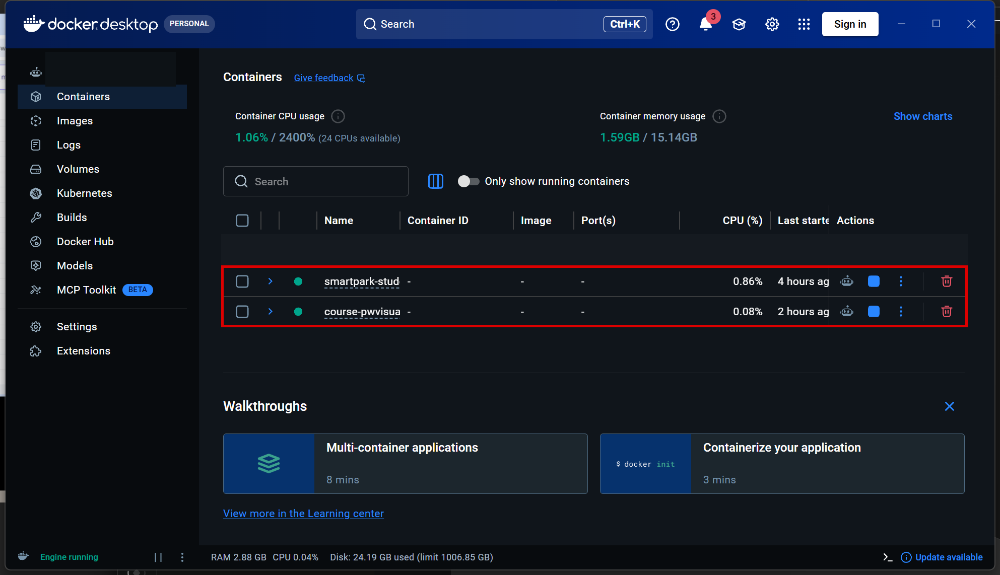、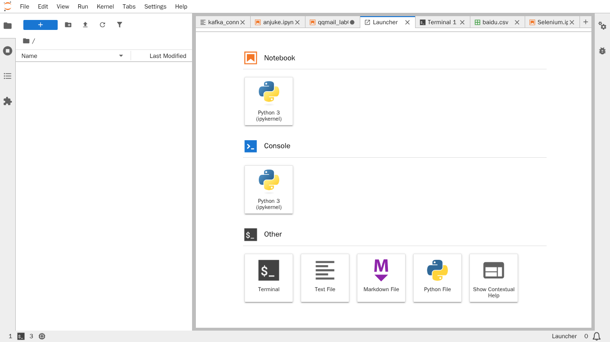、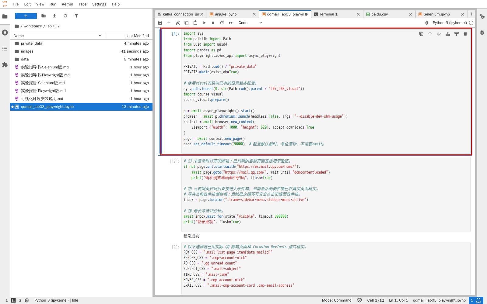、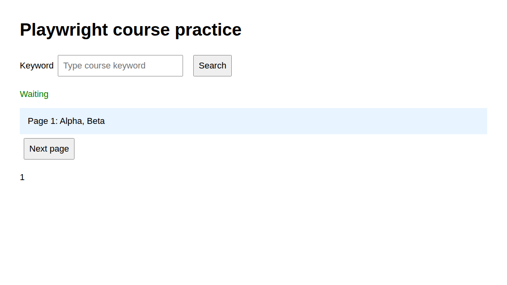。单元1红框显示教师显示配置和 Playwright 浏览器启动代码；练习页来自实际运行的可视化 Chromium，不含私人邮件。Docker 截图已遮盖个人账户与无关项目。

### 2. 扫码与登录判断

- 人工完成的操作：本人用手机 QQ 扫描 Windows 可视化窗口中的二维码，并在手机上确认登录。
- 登录成功控件的定位方式和选择器：`page.locator(".frame-sidebar-menu.sidebar-menu-active")`，定位收件箱激活的侧边栏菜单。
- 等待条件与最长等待时间：`await inbox.wait_for(state="visible", timeout=600000)`，最长10分钟。
- 本次实际结果：进入收件箱；单元2真实运行输出“登录成功”。

**截图：** 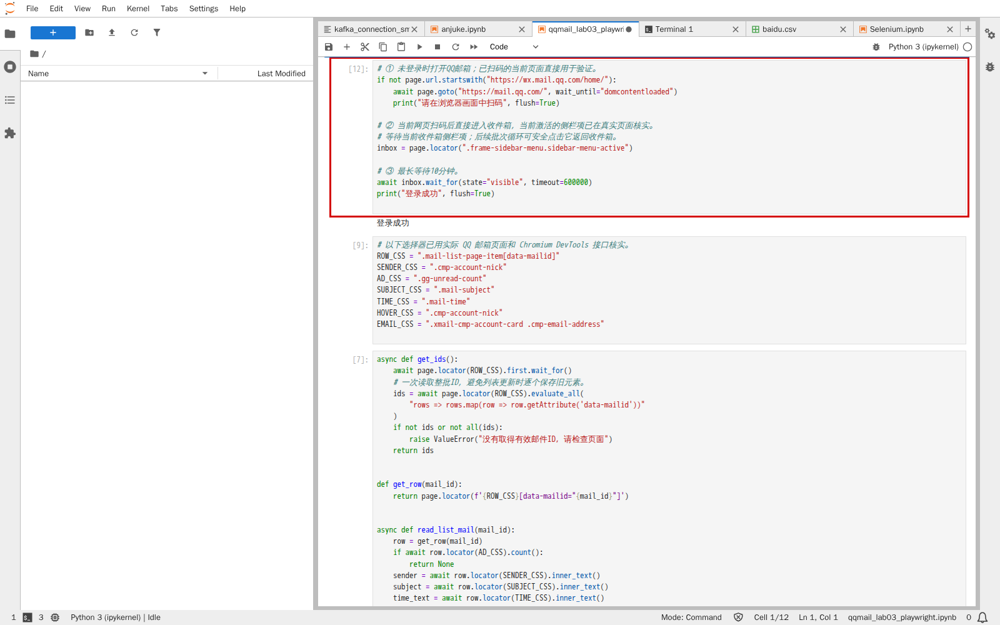。红框标出定位和等待逻辑，截图不包含二维码、Cookie、邮件列表或账号信息。

说明：程序如何区分“页面已打开”和“已经登录”？

答：打开 `mail.qq.com` 只说明登录页已加载。程序继续等待收件箱侧边栏成为可见元素；只有该控件出现才输出“登录成功”，等待超时则报错。

## 第二阶段：采集10封邮件并保存CSV（第3—4课时）

### 1. 页面分析与字段提取

| 目标 | 实际使用的定位方式 | 取值方法 |
|---|---|---|
| 一封普通邮件 | `.mail-list-page-item[data-mailid]`，并跳过含 `.gg-unread-count` 的行 | 先取 `data-mailid`，再按ID重新定位当前行 |
| 发件人 | 当前行内 `.cmp-account-nick` | `inner_text()` |
| 发件人邮箱 | 悬停当前行发件人后出现的 `.xmail-cmp-account-card .cmp-email-address` | 等待卡片可见后 `inner_text()` |
| 主题 | 当前行内 `.mail-subject` | `inner_text()` |
| 列表时间 | 当前行内 `.mail-time` | `inner_text()` |

- 如何识别并跳过聚合入口：`read_list_mail()` 检查当前行是否包含 `.gg-unread-count`；有则返回 `None`，不计入普通邮件。
- 如何确保邮箱属于当前邮件，而不是上一封的卡片：先将鼠标移到当前行时间，等待旧邮箱卡片消失；再将当前发件人滚入可视区域，等待滚动结束后悬停该发件人，并等待新卡片可见才读取地址。

**截图：** 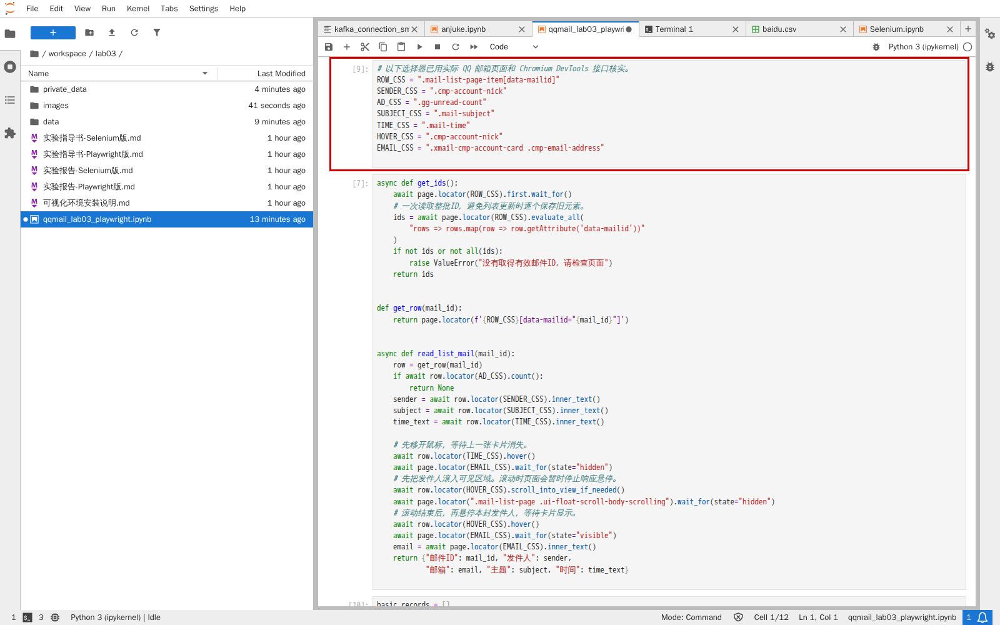。红框中的选择器在真实 QQ 邮箱页面核实后写入，解析时始终先限定当前邮件行。公开截图没有显示原始发件人或邮箱；单封逐字段页面样本截图未单独保存。

说明：选择一个字段，解释从页面节点到自己代码中选择器的过程。

答：以邮件ID为例，在 Chromium 开发者工具中检查普通邮件行，看到行节点带 `data-mailid` 属性，因此使用 `.mail-list-page-item[data-mailid]` 获取列表并读取该属性。后续按ID重新定位，减少滚动后旧元素失效的影响。

### 2. CSV保存与回读

- 原始CSV本地路径：`private_data/mail_basic.csv`
- 公开CSV路径：`data/mail_basic_public.csv`
- 实际表头：`发件人、邮箱、主题、时间`
- 成功采集的普通邮件数：10
- CSV回读数据行数（不含表头）：10
- 是否为10条、每条4字段；若不符，说明原因：是。使用 `pd.DataFrame(records, columns=BASIC_COLUMNS)` 限定4列，以 `index=False, encoding="utf-8-sig"` 保存，再用 `pd.read_csv(..., dtype=str, keep_default_na=False)` 回读；原始表和公开表均为10行4列。

**截图：** 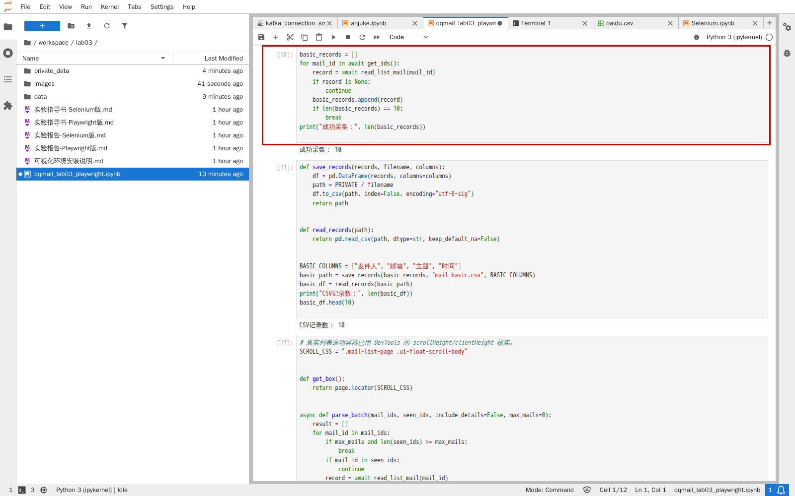、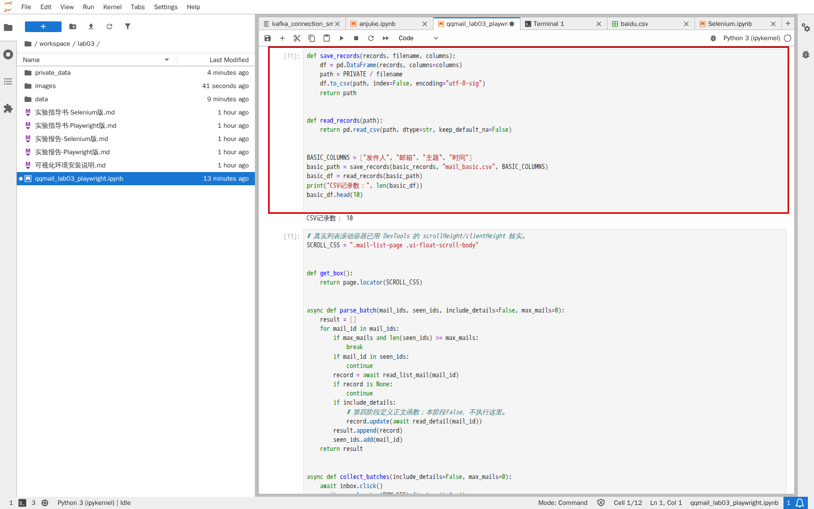。红框显示循环计数以及 `DataFrame`、`to_csv()`、`read_csv()` 和条数核对。截图只显示安全的程序输出，不展示私人邮件行。

### 3. 样本核对

选第一封、中间一封和最后一封，逐字段对照页面与CSV。公开代号与原始CSV按行对应，具体私人字段不写入报告。

| 样本 | 邮件位置或脱敏代号 | 发件人、邮箱、主题、时间是否一致 | 差异与处理 |
|---|---|---|---|
| 1 | 第1条；滚动表代号 `MAIL-0001` | CSV四字段均非空；当前未留网页逐字段核对证据 | 原始记录仅保留本地，提交前仍需本人在页面复核 |
| 2 | 第6条；滚动表代号 `MAIL-0006` | CSV四字段均非空；当前未留网页逐字段核对证据 | 同上 |
| 3 | 第10条；滚动表代号 `MAIL-0010` | CSV四字段均非空；当前未留网页逐字段核对证据 | 同上 |

**截图：** 和证明10条记录的保存与读取。第1、6、10条与网页四字段并排对照的脱敏截图**尚缺**，不能把这两张条数截图当作逐字段一致的证明。

### 第二阶段检查记录

- [x] 扫码登录和登录状态判断完成。
- [ ] 10封普通邮件采集、CSV保存和核对完成：采集与保存已完成；3条网页逐字段对照证据尚缺。
- [x] 源码、原始数据、截图和本报告已在本地保存。

未完成项与下一次需要继续的工作：如教师要求提交逐字段网页对照截图，需本人在已授权邮箱中核对第1、6、10条并制作脱敏证据；目前不声称该证据已完成。

## 第三阶段：滚动采集与邮件ID去重（第5—6课时）

### 1. 滚动与等待

- 滚动容器选择器：`.mail-list-page .ui-float-scroll-body`。
- 每批开始位置如何记录：`top = await get_box().evaluate("box => box.scrollTop")`。
- 下一屏位置如何计算：读取 `clientHeight`、`scrollHeight`，用 `min(top + height, full_height - height)` 计算下一位置。
- 怎样判断新一批已更新：滚动前保存当前 `data-mailid` 列表，滚动后 `page.wait_for_function()` 等待可见邮件ID数组变化。
- 实际停止原因（完成3批 / 末尾 / 异常，说明）：完成预设3批，无末尾或异常中止。

**截图：** 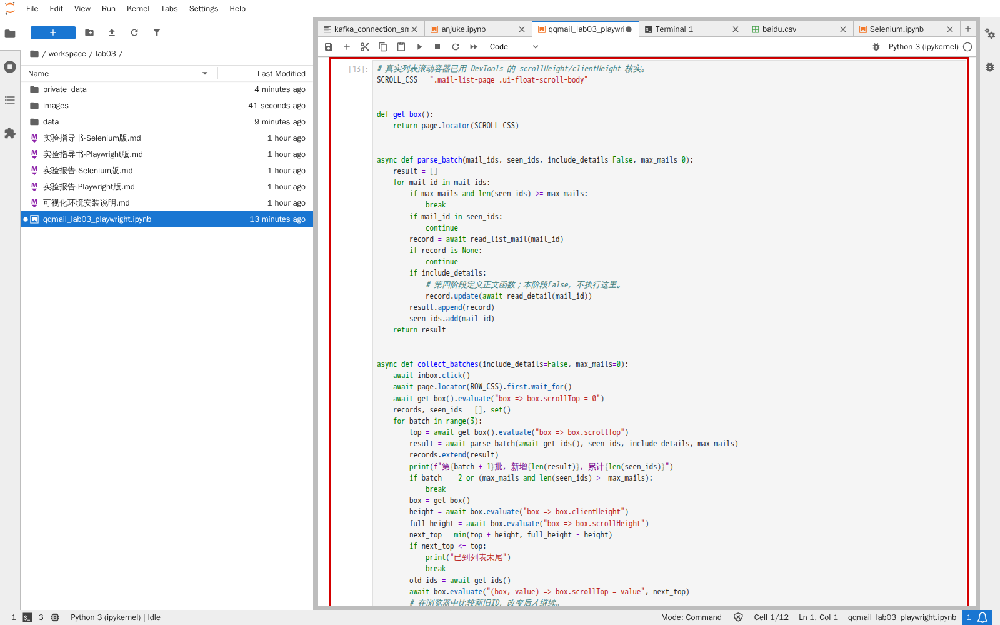、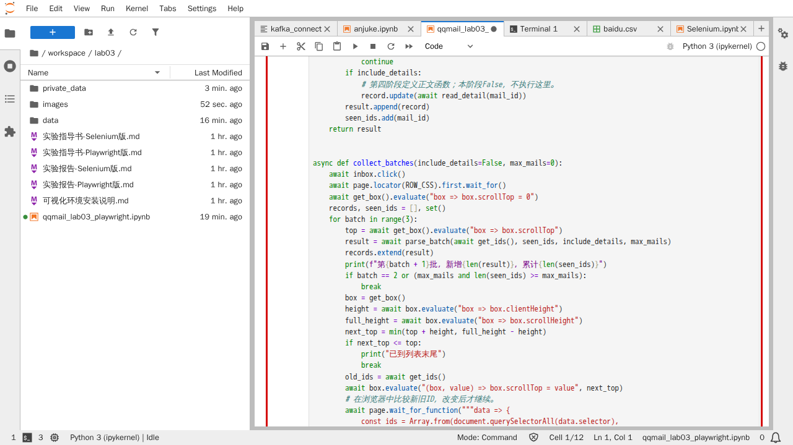、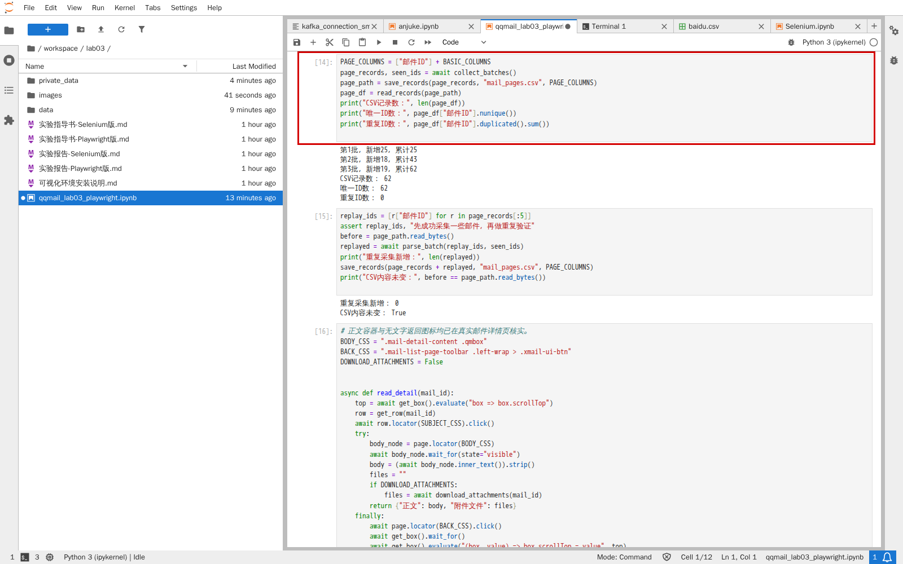。代码通过容器高度计算位置，并等待列表ID更新；日志显示三批新增数及累计数。关键代码以红框强调。

### 2. 邮件ID与去重

- 邮件ID来自哪个属性：普通邮件行的 `data-mailid`。
- `seen_ids` 在哪里创建，怎样跨批次共用：`collect_batches()` 开始时创建一个 `set()`，三批均传入同一集合；每次重新运行函数会创建新集合。
- ID何时加入集合：`parse_batch()` 读取并接受普通邮件记录后调用 `seen_ids.add(mail_id)`；已在集合中的ID直接跳过。

**截图：** 、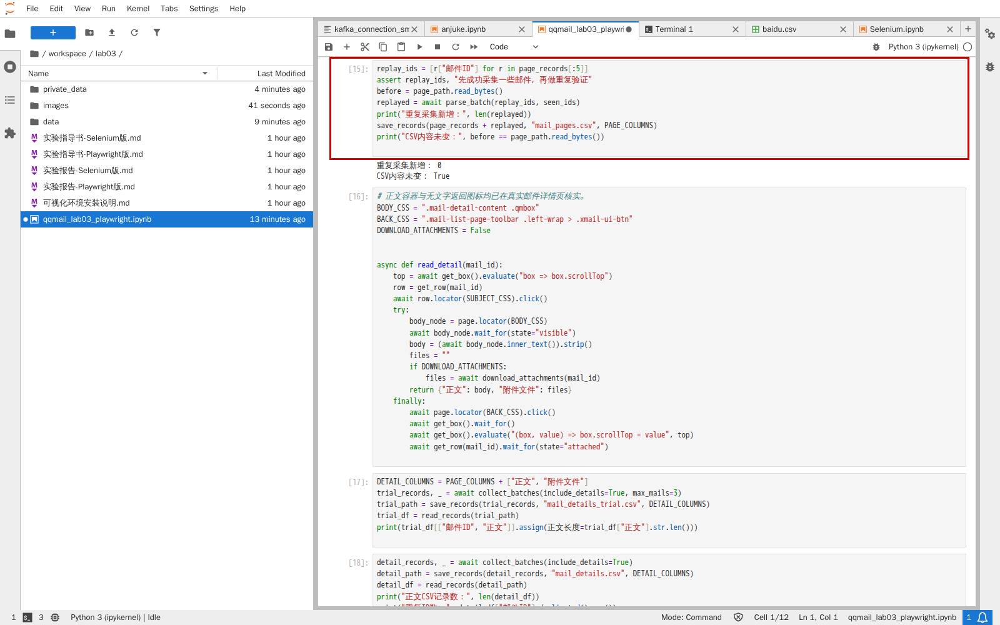。红框覆盖集合判断和实际回放输出。同一运行中再次处理已采集的5个ID，新增为0。

| 批次 | 本批新增唯一邮件数 | 累计唯一邮件数 |
|---|---:|---:|
| 1 | 25 | 25 |
| 2 | 18 | 43 |
| 3 | 19 | 62 |

- 原始CSV：`private_data/mail_pages.csv`
- 公开CSV：`data/mail_pages_public.csv`
- CSV列数及表头：5列，`邮件ID、发件人、邮箱、主题、时间`
- CSV数据行数：62
- 唯一ID数量：62
- 重复ID数量：0
- 在同一运行中重复采集已有批次，新增条数：回放已处理的5个ID，新增0条
- 重复采集后，CSV是否增加记录：否；再次保存后的文件字节与回放前相同

**截图：** 、。公开CSV保留62行和邮件ID对应关系，真实ID只在本地原始CSV中。

说明：为什么这项验证能证明去重，而仅仅关闭程序后重新覆盖CSV不能证明？

答：回放时沿用本次采集生成的同一个 `seen_ids` 集合，程序确实再次遇到已处理ID且返回0条；CSV字节也没有增加。重启后覆盖文件只表明写盘结果相同，无法证明运行中的重复行曾被集合拦截。

## 第四阶段：邮件详情与正文采集（第7—8课时）

### 1. 进入详情并返回

- 试采CSV本地路径：`private_data/mail_details_trial.csv`（仅本地核对，不提交）
- 先行测试的3封邮件代号：`MAIL-0001`、`MAIL-0002`、`MAIL-0003`
- 点击详情的定位方式：按 `data-mailid` 重新取得当前行，点击该行 `.mail-subject`。
- 正文容器选择器：`.mail-detail-content .qmbox`；等待可见后调用 `inner_text().strip()`。
- 返回列表和恢复位置的方法：进入前保存列表 `scrollTop`；在 `finally` 中点击 `.mail-list-page-toolbar .left-wrap > .xmail-ui-btn`，等待列表出现，写回原 `scrollTop`。
- 怎样重新定位滚动后的元素：不长期保存旧行句柄；每次调用 `get_row(mail_id)` 根据ID重新查询，并等待当前行重新附着。

**截图：** 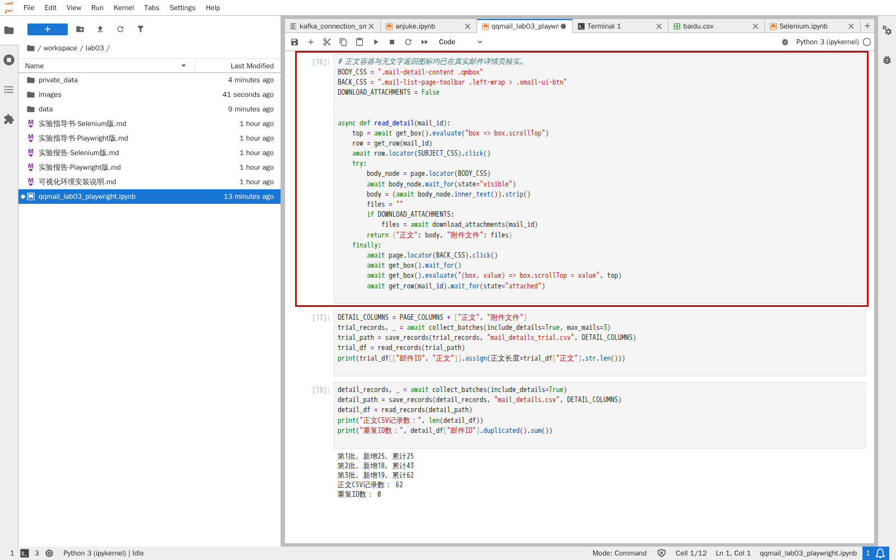。红框标出点击、正文选择器、`finally` 返回与滚动位置恢复。试采3封正文均非空，随后同一函数完成正式采集。

### 2. 接入批次循环并核对

- 计划采集批次：3批；实际完成3批。
- 正文CSV列数及表头：7列，`邮件ID、发件人、邮箱、主题、时间、正文、附件文件`
- 实际保存正文记录数：62
- 有可见文字的正文数：62
- 空正文或失败数及原因：0；本次采集的62条 `正文` 字段均非空
- 与阶段3邮件ID范围不同的原因：一致；两个CSV的62个邮件ID集合相同，均无重复
- 原始CSV：`private_data/mail_details.csv`
- 公开CSV：`data/mail_details_public.csv`

| 样本 | 邮件代号 | 正文实际字符数 | 与详情可见文字是否一致 | 返回后能否继续 |
|---|---|---:|---|---|
| 1 | `MAIL-0001` | 665 | 程序读取可见 `.qmbox` 文本；未留逐字截图 | 是，继续采集 |
| 2 | `MAIL-0002` | 969 | 同上 | 是，继续采集 |
| 3 | `MAIL-0003` | 1421 | 同上 | 是，继续采集至62条 |

**截图：** 、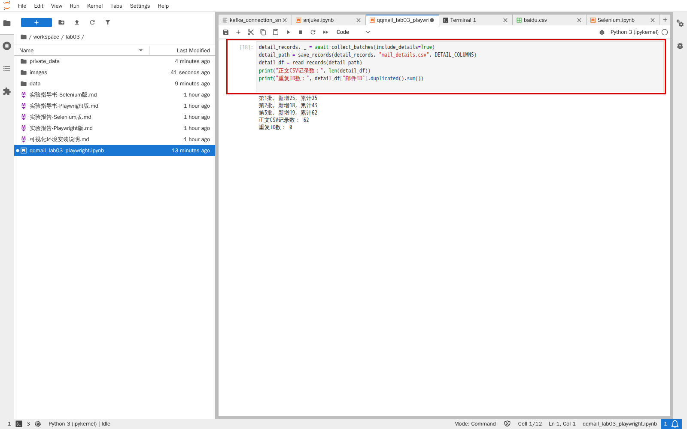。试采3条的字符数由本地原始CSV计算，报告不展示原文；正式CSV回读为62行、重复ID为0。逐字对照详情页面的脱敏截图尚缺，不能把非空和字符数当作逐字一致证明。

说明：怎样确认保存的是正文，而不是主题、摘要或整个页面？正文含换行时怎样统计邮件记录数？

答：进入详情后只等待并读取 `.mail-detail-content .qmbox`，没有从列表主题、摘要或整个页面取文本；62条正文均非空。CSV用 pandas 解析，再用 `len(df)` 统计数据行；带换行的正文仍属于一个CSV字段，不按文本文件物理行数计数。详情页逐字核对仍需独立证据。

### 3. 选做：附件下载

- 是否选做：未选做；单元13未执行
- 选做试采CSV：未创建
- 使用的无敏感练习附件类型：不适用
- 成功下载文件数：0
- 文件大小及完成状态：不适用
- 没有附件的邮件如何处理：本次未执行附件下载；正式CSV的62条 `附件文件` 字段均为空

已选做时，附下载代码与本地文件完成证据；未选做写明即可，不影响正文必做项。

## 问题与解决

- 遇到的问题、定位过程、修改及实测结果：① 浏览器运行在 Docker 内部，Windows 桌面没有普通浏览器窗口；核查可视化容器与本机入口后，打开可视化页面，用户实际看到二维码并扫码。② QQ邮箱的悬停邮箱卡片可能残留上一封的地址；先使旧卡片消失，再悬停当前行并等待新卡片可见。③ 邮件列表按自身容器滚动；用该容器的 `scrollTop`/`clientHeight`/`scrollHeight` 控制，并等待列表ID变化。④ 进入详情后页面节点变化；保存滚动位置，返回后按ID重新定位。上述代码已完成10条、3批62条及62条正文的真实运行。
- 尚未解决的问题或未完成步骤：3条基础邮件与网页逐字段对照、3条正文与详情页逐字对照均缺可提交的脱敏截图；班级、姓名、学号按原仓库 README 填写，原仓库链接已核实。附件下载为选做，未执行。

## 思考题

1. 人工扫码完成了什么？程序如何判断已经登录？为什么不能只用固定等待？

   答：本人在手机 QQ 上确认授权登录。Notebook 等待收件箱激活菜单可见后才输出“登录成功”。固定等待只经过一段时间，无法区分仍在扫码页、网络缓慢或已进入收件箱，也可能因二维码过期误判。

2. 为什么按邮件ID去重，而不按发件人或主题？结合自己的实测说明。

   答：同一发件人可以发多封邮件，不同邮件也可能同主题；`data-mailid` 对应具体邮件。本次三批累计62个不同ID、重复ID为0；用同一集合回放5个已处理ID时新增0条。

3. 列表摘要和详情正文有什么区别？返回列表后如何避免失效元素和漏采？

   答：列表展示概览字段，完整可见正文位于详情中的 `.qmbox`。点击前保存列表滚动位置，在 `finally` 中返回并恢复位置；随后按ID重新获取当前行，不复用进入详情前的旧元素。

4. 结合所选工具，说明一次真实问题的定位与修改。若使用AI，写明哪些建议经过自己的运行核对。

   答：最初浏览器在 Docker 显示服务内运行，Windows 上看不到扫码窗口。检查可视化入口并在 Windows 浏览器打开后，用户看见二维码、完成扫码，单元2实际输出“登录成功”。Codex 协助检查环境、补全代码、核对运行统计与整理报告；用户本人完成扫码确认。选择器、三批日志、CSV行列数、ID唯一性和正文非空数量均来自本机实际运行或本地文件核对；缺少逐字页面证据之处已如实标出。

## 最终统一提交检查

- [x] 四阶段在同一份报告中，已区分必做和选做；未完成项如实说明。
- [x] 原仓库本地 `lab03/` 包含 `qqmail_lab03_playwright.ipynb`、三份公开CSV、报告和14张脱敏截图；21个公开文件已暂存并核对。
- [x] 原始邮件和私人附件保留在本地；本次仓库已暂存清单不含原始CSV、Cookie、登录态、账号密码、`.env`或认证连接地址，尚未上传。
- [ ] Notebook输出已检查，GitHub上的图片和数据能正常打开：Notebook输出与本地截图、CSV已核对；GitHub尚未推送，不能声称线上已验证。
- [ ] 四阶段结束后统一上传实验三，学习通提交原作业仓库链接：尚未执行；由本人决定后续提交。

数据和截图的脱敏方法；各CSV之间怎样保持ID及字段对应关系：原始CSV仅在 `private_data/`。公开表将真实发件人、邮箱、主题、时间替换为一致的代号或保留格式的虚构地址，将正文替换为不含原文的占位说明；公开详情表的附件列为空。公开滚动表与详情表使用同一套 `MAIL-0001` 至 `MAIL-0062` 代号，保持62条记录及字段结构，基础表前10条与对应代号按顺序关联。截图仅保留程序代码、计数与无私人内容的运行画面；Docker截图遮盖个人账户及无关项目，均未见鼠标指针。

如使用AI，简述它帮助了什么，以及自己编写、修改、运行和核对了什么：Codex 按教师材料协助环境检查、Notebook代码补全、运行验证、脱敏与报告整理；本人扫码并确认登录。报告中的实际数量由本机原始CSV、公开CSV和真实Notebook输出核对，未用虚构邮件凑数。身份信息取自原仓库 README，最终仓库提交仍由本人确认。
